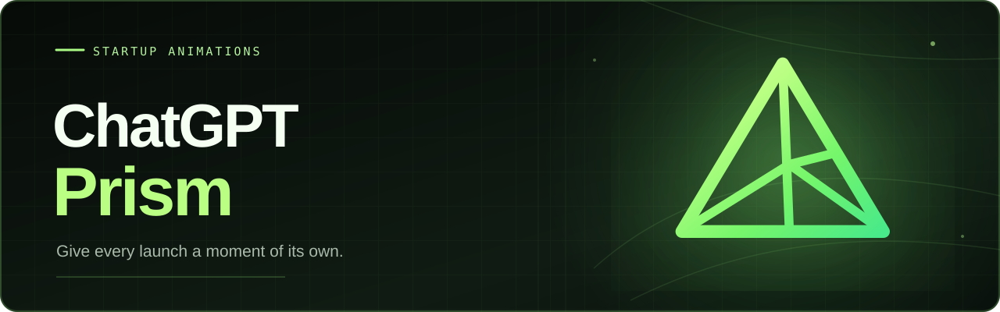

# ChatGPT Prism

<h4 align="center">
    ChatGPT Prism 为 ChatGPT/Codex 桌面客户端配置启动动画，支持 Windows 和 Darwin。ChatGPT Prism 后台启动时持续 Hook 客户端新进程的冷启动窗口，支持库内不同启动动画切换、参数自定义、本地导入和社区市场
</h4>

  <a href="README.md">简体中文</a> •
  <a href="README_EN.md">English</a> 

## 演示视频

<video controls src="assets/video.mp4"></video>

## 快速安装

- [https://github.com/tdragon6/ChatGPT-Prism/releases](https://github.com/tragon6/ChatGPT-Prism/releases)
- 包含 Windows 便携版和 Darwin 安装包（M 系芯片和 Intel 芯片均支持）
 
## 社区市场

- **作品创作 Skill**：项目内附作品创作 Skill ，使用该 Skill 结合你的创意可生成符合 ChatGPT Prism 格式的启动动画目录包
- **本地导入**：可将本地作品目录导入到 ChatGPT Prism 中，无需依赖在线社区市场
- **社区市场**：可在 ChatGPT Prism 中直接从社区市场安装作品，默认索引为 [market-index.json](market-index.json)，可在设置中自定义索引地址，方便社区作品的扩展和贡献

## 免责声明

ChatGPT Prism 在客户端新进程的冷启动阶段通过 Hook 机制介入运行，不修改系统文件或 ChatGPT/Codex 的相关文件。目前尚不确定 OpenAI 官方是否允许此类行为，请用户自行评估使用风险。若因此导致账号封禁或其他相关问题，相关风险及后果由用户自行承担，作者不承担由此产生的任何责任

## 许可

- 本项目的自有代码、随附作品及今后创作的作品统一采用 MIT 许可。项目许可见 [LICENSE](LICENSE)，各作品目录另附独立的第三方许可证
- 作品引用其他开源项目时，将第三方许可证单独存放在该作品的 `THIRD-PARTY-LICENSES` 目录，完整保留原始许可文本、版权署名及所需声明，并注明来源

